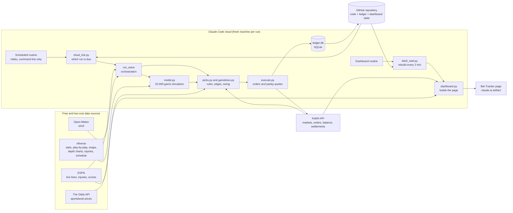
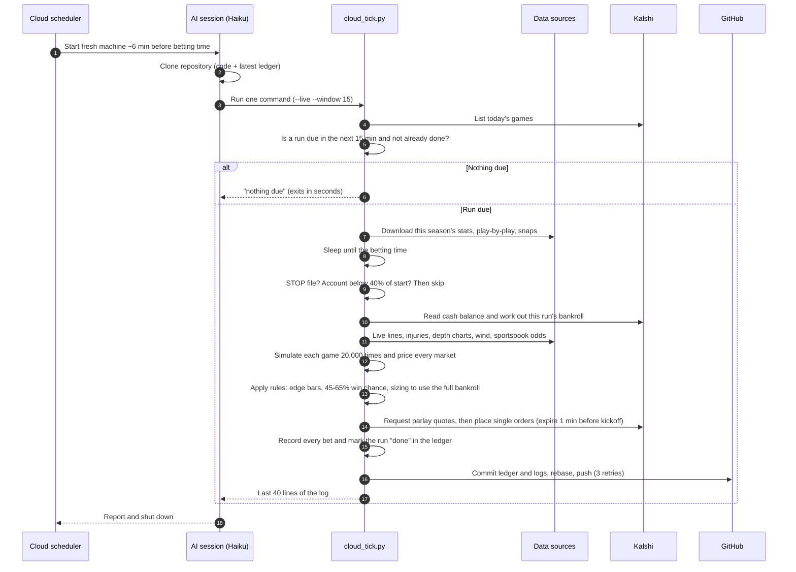
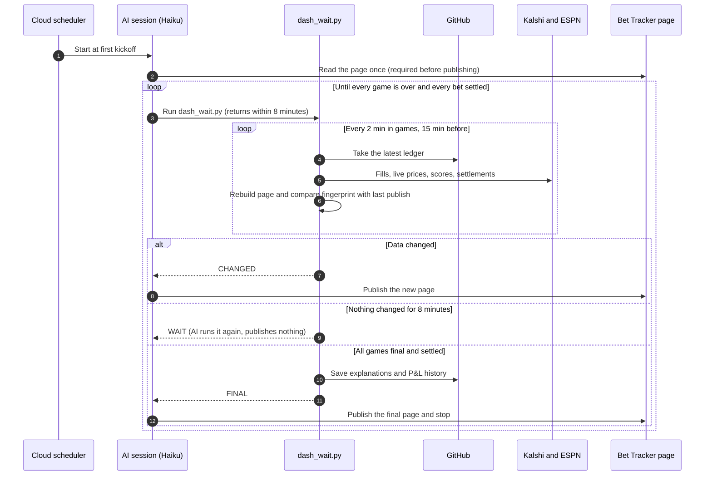
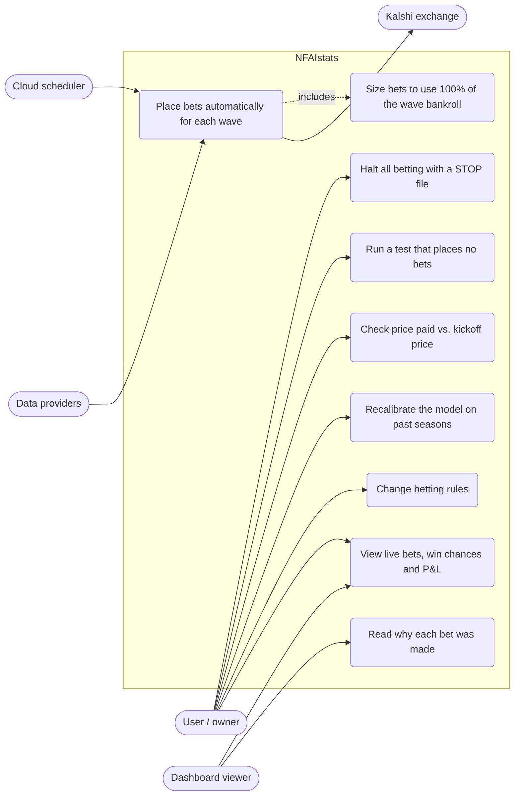

# NFAIstats Architecture Decisions

How the NFL betting system is built, and why each efficiency choice was made. It is written so a
non-specialist can follow it, with enough detail for an engineer to check.

## 1. The system in one paragraph

Before each group of NFL games, a program downloads recent football stats and simulates each game
thousands of times. That gives a probability for every player stat and game line on Kalshi, such as
"Player X gets 60+ receiving yards". It compares that probability with Kalshi's price and
sportsbook odds, picks the bets with an edge, sizes them to use the full bankroll, and places them
through Kalshi's API. A dashboard tracks results live. All of it runs in Claude Code's cloud, so no
laptop has to stay on.

**The guiding principle:** plain Python code does the repetitive, predictable work. The AI is used
only when a task needs it, and as little as possible, because AI time (tokens) is the most
expensive resource here.

## 2. Overall architecture

The system has five layers. Each one does one job and passes plain data to the next. That keeps every
part testable on its own, and lets the expensive parts (AI, network) stay at the edges.

| Layer | Component (file) | Responsibility | Why it is built this way |
|---|---|---|---|
| Scheduling | Claude Code cloud routines | Start a fresh cloud machine a few minutes before each betting time | No server to run or pay for between jobs; one run per betting time, so no idle polling |
| Orchestration | `scripts/cloud_tick.py`, `scripts/run_day.py` | Decide which betting run is due, wait for its time, run it, save the record to GitHub | Plain Python, so a run is repeatable and costs almost no AI tokens |
| Data | `nfai/data.py`, `nfai/slate.py`, `nfai/odds.py` | Football stats (nflverse), schedule, live lines and injuries (ESPN), weather (Open-Meteo), sportsbook odds (The Odds API), Kalshi markets | Every source is free or low cost; results are cached on disk and fetched once per run |
| Decision | `nfai/model.py`, `nfai/picks.py`, `nfai/gamelines.py` | Simulate games, turn results into win chances, compare with prices, apply the betting rules, size each bet | Numerical work is vectorized; rules sit in one file, so a rule change is a one-line edit |
| Execution and record | `nfai/kalshi.py`, `nfai/execute.py`, `ledger/ledger.db` | Sign and send orders, request parlay quotes, record every bet and run | Signed API calls with spending guards; a single SQLite file versioned in Git |
| Reporting | `scripts/dashboard.py`, `scripts/dash_wait.py`, Bet Tracker page | Build the live results page and publish it when something changes | The page is rebuilt by code; the AI only publishes it, and only when the data changed |

**Design principles behind the whole system**
1. **Deterministic core, thin AI shell.** Everything that decides money is ordinary code with fixed
   inputs and outputs. The AI is a launcher and publisher, never a decision maker. That makes runs
   cheap, auditable and repeatable.
2. **Stateless compute, durable state in Git.** Cloud machines are thrown away after each run. The
   only state that matters (the ledger, the dashboard history, the cached explanations) lives in the
   GitHub repository, so any run can start from scratch and pick up where the last one left off.
3. **Fail safe, not fail open.** Missing data, a stale line, a low balance or a STOP file each make
   a run skip bets rather than guess.
4. **Pay for work only when there is work.** No always-on server, no polling loops waking the AI, and
   no repeat downloads of data that has not changed.

## 3. Block diagram

How the parts connect. Arrows show the direction data flows.

## 4. Sequence diagrams

### 4.1 One betting run (for example, the Sunday 10 AM games)

### 4.2 Live dashboard update

## 5. Use case diagram

Who uses the system and what each can do. Standard UML use case notation isn't supported by the
diagram renderer, so actors are drawn on the left and use cases as rounded boxes.

| Use case | Actor | What happens | Main safeguard |
|---|---|---|---|
| Place bets automatically | Cloud scheduler | A run starts before each wave and bets with no human involved | Runs are marked done, so they never bet twice |
| Size to 100% of bankroll | System | Stakes are scaled up, and edge bars step down until the bankroll is used | Bars never go below the agreed floors |
| Halt all betting | User | Add a STOP file to the repository | Checked before every run |
| Test run | User or developer | Any run with a test option simulates and logs bets without placing them | Test options force dry-run mode |
| View the dashboard | User or anyone with the link | Live bets, win chances, results and season P&L | Read-only page |
| Read why | Viewer | Each bet shows the model's reasoning | Worked out once per bet and cached |
| Price check (CLV) | User | Compares the price paid with the price at kickoff | Read-only |
| Recalibrate | Developer | A walk-forward backtest refits the calibration | Changes are judged by Brier score before going live |
| Change rules | User via developer | Rules live in `picks.py` and `CLAUDE.md` | Each change is versioned in Git |

## 6. At a glance

| Area | Decision | Why |
|---|---|---|
| AI cost | Betting runs need no AI reasoning; the AI just starts one command | Model math runs as code, which is free and repeatable |
| AI cost | Smallest model (Haiku) for cloud jobs | The jobs are mechanical; a larger model would add cost without adding value |
| AI cost | AI wakes only when the dashboard actually changes | No tokens spent while nothing is happening |
| AI cost | One cloud run per betting time instead of an hourly check | About 6 sessions a week instead of about 30 |
| Network | Download only this season's files; keep history on disk | History never changes, so there is no need to download it again |
| Network | One request for the whole league instead of one per game | Fewer calls, and per-game data was incomplete |
| CPU | Vectorized simulation: 20,000 games at once as arrays | Tens to hundreds of times faster than a Python loop |
| CPU | Simulate each team once, then read every prop from those results | Extra prop thresholds cost almost nothing |
| Memory | Load data once per betting run and share it across games | No repeated parsing |
| State | SQLite file saved in GitHub | Cloud sessions keep no memory between runs; GitHub is the record |
| Safety | Test runs never bet; a STOP file halts everything; finished runs never repeat | Real money is involved |

## 7. Minimizing AI (token) usage

Tokens are the units AI usage is billed in. The user asked that they be treated as a very
high-value currency, so this was the top priority.

**7.1 Code does the work; the AI only starts it.** Projections, pricing, sizing and order placement
are ordinary Python. In a cloud betting run, the AI's whole job is to run one command and report the
last 40 lines. The AI does not make the betting decisions; the code does. That makes runs cheap and
gives the same result for the same inputs, so they can be checked afterward.

**7.2 The smallest model that can do the job.** Cloud jobs use Haiku, Anthropic's smallest and
cheapest model. Running a command and publishing a page needs no deeper reasoning.

**7.3 Only the tools the job needs.** Cloud runs may use only the command line. That keeps
instructions short and keeps the session from wandering into reading files or exploring.

**7.4 Trimmed output.** Simulation logs run to thousands of lines. The command filters out routine
"skipped" lines and keeps only the last 40. The AI reads only what it needs to report, and every line
it reads costs tokens.

**7.5 The AI wakes only when something changed.** The live dashboard rebuilds every 2 minutes during
games. A small script (`scripts/dash_wait.py`) does that loop with no AI involved. Each time, it
computes a fingerprint (an MD5 hash) of the page with the timestamps removed. The AI is woken only
when the fingerprint differs from the last published one, meaning a score, fill or result actually
changed. The script then prints one word (CHANGED, FINAL or NOBETS), so the AI never has to read the
page to decide what to do.

**7.6 Refresh adapted to the game clock.** Before kickoff nothing moves, so the dashboard checks
every 15 minutes. During games it checks every 2 minutes. When every game is final, it stops.

**7.7 One cloud run per betting time instead of polling.** An hourly cloud check on game days would
mean about 30 sessions a week, and most would find nothing to do. The weekly betting times are known
in advance: early, morning, 1:05, 1:25, night and Monday. So one run is scheduled about 15 minutes
before each. That means about 6 sessions a week, none wasted. If a check does run with nothing due,
it exits in seconds.

**7.8 Reusing one AI session for repeated publishing.** On the laptop version of the dashboard, the
publishing step reuses one AI conversation rather than starting a new one each time. The AI then
doesn't need setup instructions repeated for every update.

## 8. Network and data downloads

**8.1 A local cache of historical data.** Football data (play-by-play, weekly stats, snap counts,
injury reports) comes from nflverse, a free public source. Past seasons never change, so they are
downloaded once and kept on disk. Before each betting run, only this season's three changing files
are downloaded again: stats, play-by-play and snaps.

**8.2 The schedule is refreshed only when it's over 12 hours old.** The schedule file is reused if
it's recent and downloaded again if not. That saves a download on most runs and guarantees the file
is never days out of date. A stale file once caused bets to be priced on an old point spread;
section 12 has the details.

**8.3 One league-wide request instead of one per game.** The injury report is fetched once for the
whole league rather than once per game. That's fewer calls, and the per-game version only listed 5
players per team, so it also missed players. In the same way, one ESPN scoreboard request returns the
current betting line for every game that day.

**8.4 Kickoff prices are saved once, never fetched again.** The price-tracking report
(`scripts/clv.py`) compares what we paid with Kalshi's price at kickoff. Each kickoff price is
fetched once and saved to the database, so running the report again makes no new requests.

**8.5 Weather only where it matters.** Wind forecasts are requested only for outdoor stadiums. Indoor
games skip the call.

## 9. CPU: how the simulation stays fast

**9.1 Vectorized Monte Carlo simulation.** The model plays out each game 20,000 times with random
variation. That includes pace, whether a team is ahead or behind, each player's share of targets and
carries, catches and yards. A simple version would loop 20,000 times in Python, which is slow. This
one uses NumPy to run all 20,000 at once as one block of numbers, so a single instruction handles
20,000 values in fast, optimized code. That's typically tens to hundreds of times faster, and a whole
Sunday slate simulates in seconds to a few minutes.

**9.2 Simulate each team once and share the result.** Each team is simulated once per game. The
team-level draws, like how many plays happen and how often they pass, are shared by every player on
that team. That has two benefits:
- **Speed:** each additional bet costs almost nothing. "60+ yards", "80+ yards" and "100+ yards" for
  one player are read from the same 20,000 results by counting how many go over each line. There's no
  new simulation.
- **Accuracy:** a team's players are linked the way they are in real life. If the quarterback has a
  big day, his receivers usually do too. That matters for parlays, which combine several outcomes.

In engineering terms, the cost grows with the number of players times the number of simulations,
O(players × sims). It doesn't grow with the number of betting markets.

**9.3 One pass over the data for team ratings.** Offense and defense ratings for the whole league are
computed by grouping play-by-play data by team, using pandas groupby. That makes one pass over
roughly 50,000 plays a season, rather than a separate scan for each team.

**9.4 A fixed random seed.** The same inputs always give the same projections. That's not about
speed: it makes results reproducible and lets past runs be checked exactly.

**9.5 What was deliberately not optimized.** The data is small: a few seasons of football, tens of
megabytes. Parallel processing, a database server or faster file formats like Parquet would add
complexity for no visible gain. We kept the simple version and spent effort where the costs actually
are: AI tokens and correctness.

## 10. Memory

- **Load once, use many times.** Each betting run loads the season's data into memory once. The model
  object built from it is reused for every game in that run, so files aren't parsed again per game.
- **Small working set.** The biggest in-memory items are the simulation arrays, about 20,000 numbers
  per stat per player, a few megabytes per team. They're discarded after each game. A cloud machine
  handles this easily.
- **Only needed files are kept.** Downloaded data files are excluded from the GitHub repository, so
  cloud sessions start with a small checkout and fetch only what they need.

## 11. Cloud architecture and saving state

**11.1 Claude Code cloud instead of a rented server.** The user preferred not to manage AWS or
DigitalOcean servers. Claude Code's scheduled cloud runs start a fresh machine, run the job and shut
down, so there's no server to maintain or patch and nothing runs between jobs.

**11.2 The cloud keeps no memory between runs, so GitHub stores everything.** Every cloud session
starts from a clean copy of the code. The record of every bet (`ledger/ledger.db`, a single SQLite
database file) and the logs are committed back to GitHub after each run. The next run starts by
reading that record. If two runs overlap, the save step pulls the latest version first and retries up
to 3 times.

**11.3 SQLite instead of a database server.** One file holds the whole ledger: no server, no cost, and
easy to version in Git. At a few hundred bets a week, that's plenty.

**11.4 The Python environment is built once per machine.** The cloud machine's default Python setup
didn't match the needed version, so the run builds a dedicated environment only if one doesn't
already exist.

**11.5 Keys are never stored in code.** Kalshi and odds API keys are passed to the cloud as
environment variables and are never in the repository. The code accepts the key in either common
format, so a pasting difference can't break a run.

## 12. Safety and correctness decisions

Real money is involved, so some choices favor safety over speed or simplicity.

- **Test runs never bet.** Any run with a test option, such as a specific date or "run now", is forced
  to dry-run mode whatever else is set. Live betting needs an explicit live switch.
- **A completed betting run never repeats.** Each run is marked done in the ledger, and later checks
  skip it, so the same bets can't be placed twice.
- **A late start still counts within limits.** If a cloud run starts late, it still bets as long as
  kickoff is at least 10 minutes away. Otherwise it skips.
- **One switch stops everything.** A file named STOP, on the laptop or in the GitHub repo, halts all
  betting.
- **No bets on old data.** In one incident, game-line bets were priced on a schedule file whose point
  spread was days old (Baltimore -3 when the market had Jacksonville -8.5). The fix:
  - lines now come from ESPN's current odds;
  - the schedule file is downloaded again when it's over 12 hours old;
  - game-line bets are refused outright when no current line is available.
- **Account safety stop.** Betting runs are skipped if the account drops below 40% of its starting
  balance.

## 13. Trade-offs and known limits

- **Cloud start delay.** Cloud sessions usually start a few minutes late. Scheduling each run 15
  minutes before betting time absorbs that.
- **Hourly minimum on recurring schedules.** Cloud schedules can't repeat more often than once an
  hour. That's why the 2-minute dashboard refresh runs as a loop inside one session instead of a
  schedule.
- **Not yet proven:** how reliable a single long dashboard session is over a full Sunday, and what it
  costs in tokens. It'll be measured on the first full cloud Sunday.
- **Model accuracy over speed.** The main open model issue is that quarterback pass attempts and
  completions are projected about 5-6 too high. Fixing that is worth more than any further speed work.
